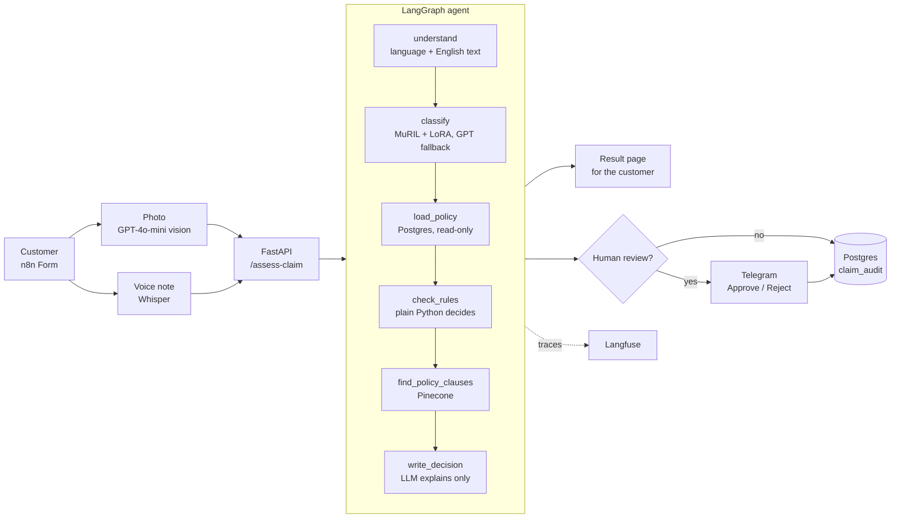

# Multimodal Motor Insurance Claim Agent

An AI claims assistant for a fictional Indian motor insurer, **ShaikSure Motor Insurance**.
A customer files a claim with a **photo**, a **text description** and an optional **voice note** (English or Hinglish).
The system reads all three, checks the policy, estimates the repair cost, cites the policy clauses, and decides:
**approve**, **reject**, **human review** or **need more info**. Risky claims go to a human adjuster on Telegram.

> All data, policies and photos are synthetic (AI-generated). ShaikSure is not a real company.

## Results

| What | Result |
|---|---|
| End-to-end evaluation (20 test claims, all decision paths) | **20/20 decisions correct**, claim type 18/19 (94.7%) |
| Claims handled by the fine-tuned model | 14 of 20 (all correct); 6 sent to the GPT-4o-mini fallback |
| Fine-tuned classifier speed (CPU) | **~14 ms per claim**, vs ~700 ms for GPT-4o-mini |
| Trainable parameters with LoRA | **0.13%** (299,526 of 237.9 million); adapter file 7.6 MB |

Details: [`eval/eval_results.csv`](eval/eval_results.csv), [`eval/classifier_results.json`](eval/classifier_results.json), [model card](docs/MODEL_CARD.md).

## Architecture



**Design rule: rules decide, the LLM explains.** Money decisions must be predictable and auditable, so plain Python
rules make the decision and the LLM only writes the explanation. It never changes the outcome.

## How a claim flows

1. **n8n Form**: policy number, incident date, description, damage photo, optional voice note.
2. **Photo → GPT-4o-mini vision**: is it a car, which parts are damaged, how severe, does it match the story.
3. **Voice → Whisper**: speech to text (English or Hinglish).
4. **LangGraph agent** (FastAPI service, 6 steps):
   - **understand**: detects English or Hinglish and makes an English version for the adjuster.
   - **classify**: fine-tuned **MuRIL + LoRA** predicts the claim type (collision, theft, flood, fire, vandalism, glass only). If its confidence is below 0.23, **GPT-4o-mini** decides instead.
   - **load_policy**: policy, vehicle, claim history and limits from **Postgres** (read-only role). Unknown policy → *need more info*.
   - **check_rules**: plain Python: cover type, policy dates, exclusions, repair cost from a price table, deductible, payout limit, and review flags (loss above ₹50,000, new policy, repeat claims, photo mismatch, not a car).
   - **find_policy_clauses**: fetches the exact policy clauses the rules named from **Pinecone** (metadata filter), falling back to semantic search.
   - **write_decision**: GPT-4o-mini writes an English note for the adjuster and a customer message in the customer's language (English or Hinglish, English letters).
5. **Customer** sees the decision on the form page.
6. **Human review** claims go to **Telegram** with Approve / Reject buttons.
7. Every final decision is saved to the **`claim_audit`** table (insert-only role), with the Langfuse trace ID.
8. If any step fails, an **error workflow** sends a Telegram alert naming the failed node.

## Tech stack

| Area | Tools |
|---|---|
| Fine-tuning | Hugging Face Transformers, PEFT (LoRA), Google MuRIL, Colab T4 GPU |
| Agent + API | LangGraph, LangChain, FastAPI, Pydantic |
| Multimodal | GPT-4o-mini vision, Whisper |
| Retrieval (RAG) | Pinecone, OpenAI `text-embedding-3-small` |
| Data | Neon Postgres (read-only and insert-only roles) |
| Automation | n8n (form, ingestion, approval, audit, evaluation, error alerts), Telegram |
| Observability | Langfuse tracing |
| Deployment | Docker |

## Repository layout

```
agent/        classifier.py (MuRIL + LoRA + GPT fallback), graph.py (LangGraph agent), main.py (FastAPI)
models/       claim_classifier_lora/ (LoRA adapter, 7.6 MB)
training/     train_claim_classifier.ipynb (Colab notebook: fine-tuning + GPT comparison)
n8n/          Claim Intake, Ingest - Policy PDFs, Evaluation, Error Alert workflows
data/         claims/ (synthetic tables + training text), policy_docs/ (4 policy PDFs), test_claims/ (photos, voice notes)
eval/         test_claims.csv, eval_results.csv, classifier results
scripts/      database schema, data loader, database roles, n8n start script
docs/         DATA.md, MODEL_CARD.md
```

## Run it

**1. Keys.** Copy `.env.example` to `.env` and fill in: `OPENAI_API_KEY`, `PINECONE_API_KEY`, `DATABASE_URL` (owner, setup only),
`AGENT_DATABASE_URL` (read-only role), `LANGFUSE_PUBLIC_KEY`, `LANGFUSE_SECRET_KEY`, `LANGFUSE_HOST`.

**2. Database (Neon Postgres).**
```bash
pip install -r requirements.txt
python scripts/setup_database.py          # creates tables and loads the synthetic data
```
Then run `scripts/agent_reader_role.sql` and `scripts/audit_writer_role.sql` in the Neon SQL Editor (one statement at a time, with your own passwords).

**3. Policy clauses → Pinecone.** Create a 1536-dimension cosine index `shaiksure-policies`, import `n8n/Ingest - Policy PDFs.json` and run it (55 clauses).

**4. Agent API.**
```bash
pip install torch --index-url https://download.pytorch.org/whl/cpu
pip install -r requirements.txt
uvicorn agent.main:app --port 8000        # docs at http://127.0.0.1:8000/docs
```
Or with Docker:
```bash
docker build -t shaiksure-claim-agent .
docker run --env-file .env -p 8000:8000 shaiksure-claim-agent
```

**5. n8n.** `./scripts/n8n_start.sh`, then import the workflows in `n8n/`, add the OpenAI, Telegram and Postgres
(insert-only role) credentials, set **Error Alert - ShaikSure** as the error workflow of **Claim Intake - ShaikSure**, and publish.

**6. Evaluate.** Run the **Evaluation - ShaikSure** workflow. It sends the 20 claims in `eval/test_claims.csv` to the agent and reports accuracy.

## Engineering decisions

- **Fine-tuned small model first, GPT as fallback.** On hard test claims GPT-4o-mini was more accurate, but ~50× slower and paid per call. A confidence cascade keeps most claims fast, free and private, and sends uncertain ones to GPT.
- **MuRIL instead of DistilBERT.** Version 1 (English DistilBERT) failed on Hinglish words like *gaadi* and *paani*. MuRIL is pre-trained on Indian languages, including Hindi written in English letters.
- **SQL for numbers, RAG for wording.** Payout limits and deductibles come from Postgres because they must be exact. Policy wording comes from Pinecone so every decision can quote a clause.
- **Exact clause lookup before semantic search.** Pure similarity search sometimes returned a related but wrong clause (e.g. vandalism rules for a collision). When the rules already know the section, it is fetched exactly with a metadata filter.
- **Least privilege.** The agent's database role can only `SELECT`; the n8n audit role can only `INSERT` into `claim_audit`. A prompt injection cannot change or delete data.
- **Secrets never in the image or repo.** Keys live in `.env` (git-ignored) and are passed to Docker at run time.

## Problems found and fixed

- **Underfitting:** the first MuRIL run gave every prediction a confidence close to random (≈0.18 for 6 classes). Training for 30 epochs instead of 10 fixed accuracy, and the GPT fallback threshold was tuned on held-out data.
- **20-second first request:** Langfuse traces showed the first classification on CPU took ~20 s. A warm-up prediction at server start fixed it.
- **Colab dependency clash:** Colab's pre-installed `torchao` blocked `peft`; it was removed in the notebook.
- **Form uploads failing in Codespaces:** the private forwarded port blocked browser uploads to the n8n form; the form works on a public port during testing.
- **Wrong clauses cited and wrong customer wording:** fixed with exact clause lookup and stricter message rules (an approval never mentions a review).

## Limitations and future work

- All data is synthetic. Real claims need testing and retraining on anonymised real data.
- Classifier confidence is not calibrated; the 0.23 threshold was tuned on a small hard test set (48 claims). Temperature scaling or more data would improve it.
- The classifier reads only text. In one tricky test (a windshield story with a photo of bumper damage) the claim type came out as collision instead of glass only; the photo-mismatch rule still sent it to a human, so the decision was correct.
- The photo's car type is not compared with the insured vehicle (e.g. an SUV photo on a sedan policy). This would be a useful fraud check.
- English and Hinglish only; Hindi script, Telugu and other Indian languages are future work.
- Payout uses a simple price table; real settlement also applies depreciation (Section 4) and a surveyor's assessment.

## Author

**SK Ibrahim**: [LinkedIn](https://www.linkedin.com/in/sk-ibrahim-ai)
